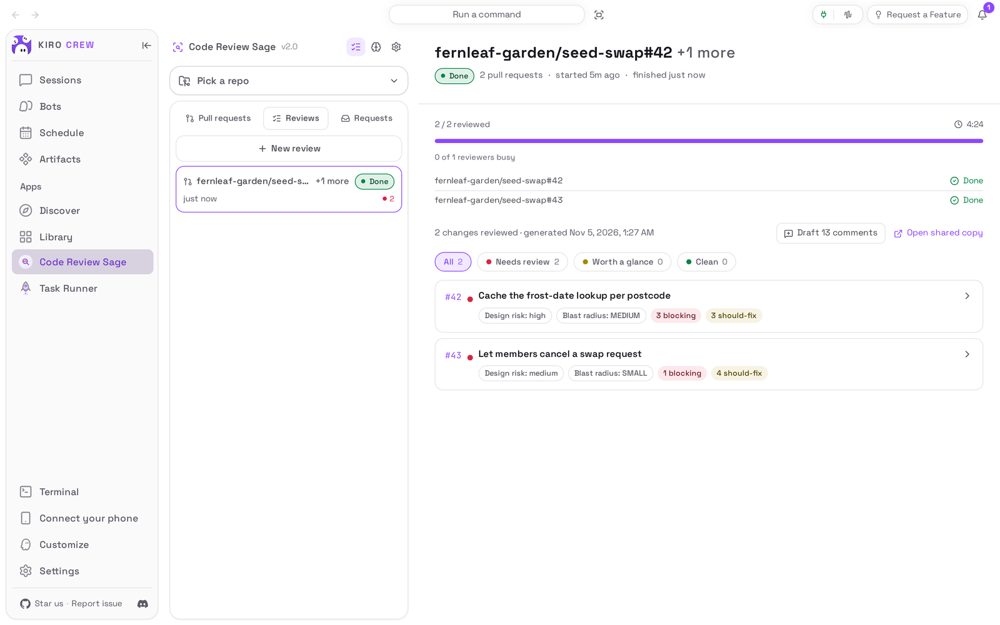

# Code Review Sage

<picture>
  <source media="(prefers-color-scheme: dark)" srcset="docs/media/hero-dark.png">
  
</picture>

**Find out which pull requests need your attention before you open them.**

Code Review Sage is an app for [Kiro Crew](https://github.com/kirodotdev/KiroCrew),
the open-source personal AI agent.

## What it is

Code Review Sage adds a **Code Review Sage** page to Kiro Crew. You pick a
GitHub repository, tick the open pull requests you want reviewed, and an agent
reviews each one in a session of its own: it reads every changed file, judges
the design, looks for the problems that would hurt after merging, and weighs
each change by how much of the code it can affect. The results come back as a
**Focus Report** that sorts the pull requests into **Needs review**, **Worth a
glance** and **Clean**, with each finding written up so you can decide what to
do about it.

**Get started:** open **Apps → Library** and choose **Enable** on the **Code
Review Sage** tile under **Disabled** (see [Install](#install)).

## The problem it solves

A busy repository has more pull requests than anyone can read carefully. Most
are fine; a few change something that will bite later, and those look exactly
like the rest in a list of titles. Code Review Sage reads them first, so the
ones that deserve your full attention are at the top and you know what to look
for when you open them.

It reviews; it does not decide. Nothing is written to a pull request unless you
choose to send a finding, and even then it is staged as a draft review that
only you can see until you publish it on GitHub.

## Top 3 use cases

### 1. Review the open pull requests of a repository

You look after a community seed-swap website and three pull requests came in
overnight. You open **Code Review Sage**, choose the repository, tick the two
that change behaviour and choose **Review 2 selected**. You can leave the page:
a notification tells you when the review lands. Pull requests that ask for
your review on GitHub are also listed under **Requests**.


### 2. See which changes deserve your attention

When the review is done, the **Focus Report** lists every reviewed pull request
with its band, its design risk, its blast radius (how much of the code a change
can affect) and how many blocking and should-fix findings it has; the band
chips at the top filter the list. Open a pull request to read the reviewer's
verdict on its design first. In the capture below, the reviewer agreed that
caching frost dates is worth doing, and said why this cache is not the way to
do it.


### 3. Read the findings and decide what to send

Further down, each finding says what it observed, why it matters and what to
change, pointing at the line it is about, and a ship-readiness summary says
whether the pull request is ready to merge. In the capture below, the reviewer
found that any signed-in member could cancel anyone else's swap request. A finding you will not send can be dismissed with a reason; the
ones worth sending go to the pull request as a draft review when you choose
**Draft this finding** (or **Draft N comments** for all of them).


## Watch it


[Watch the walkthrough as a video (MP4)](docs/media/walkthrough.mp4).

<sub>Recorded from a real Kiro Crew (`55439d8770`, with only the built-in copy removed) on a throwaway home, running this repository's own copy of the app. The GitHub shown is invented: the `fernleaf-garden` organisation, its repositories, pull requests and people are served by a stand-in for the `gh` tool (capture/README.md), so the links lead nowhere. The review was started from the page in the recording and the stills above were taken on the same gateway right after it. Every finding came from a live model reading those pull requests, so the wording and the counts will differ on every run. The wait while the two pull requests were reviewed, one after the other, was shortened (about four and a half minutes).</sub>

## Install

**Today: Code Review Sage comes with Kiro Crew.** Nothing needs downloading. It
starts switched off:

1. In Kiro Crew, open **Apps → Library** in the left sidebar.
2. Find the **Code Review Sage** tile in the **Disabled** section, below the apps
   that are already on.
3. Choose **Enable** on the tile (it is also in the tile's **⋯** menu).
4. **Code Review Sage** now appears under **Apps** in the sidebar.

The copy that comes with Kiro Crew can also open a pull request's description,
checks and file changes inside the page, publish the draft review from the
page, and start a follow-up chat with the reviewer. This repository's copy,
pictured here, cannot do those three yet (see [Development](#development)); it
links to the pull request on GitHub instead, and can only continue a follow-up
chat that already exists.

**Coming later: from the Kiro Crew App Store.** Once this app is listed there:

1. Open **Apps → Discover** in the left sidebar.
2. Search for **Code Review Sage** and choose **Install**.
3. Kiro Crew asks **Trust “Code Review Sage” to run its own code?** Code Review
   Sage runs a small program of its own inside Kiro Crew to keep your reviews
   and to start and watch the reviewer. Trusting it gives that program the same
   access Kiro Crew has (your files, your saved sign-ins and the internet), as
   the dialog says. If you are happy with that, choose **Trust this app**. You
   can take it back later in **Settings → Security → Third-party apps**.
4. The app installs switched off. Choose **Enable** on its page.

What you need: Kiro Crew on a Mac, Linux or Windows computer that can already
chat, and the GitHub command-line tool `gh` installed and signed in on that
computer for the GitHub account that can read your repositories (the page
tells you how if it is missing).

## First run

The page opens with **Pick a repo to see its pull requests.** Choose **Add a
repo** and pick a repository from the ones your GitHub account can reach, or
type `owner/repo` or paste a repository or pull request link. Added
repositories stay in the menu at the top of the page.

## How to use it

1. Choose the repository in the menu at the top. Its open pull requests appear
   under **Pull requests**; **Filter pull requests** and **Labels** narrow the
   list.
2. Tick the pull requests you want reviewed and choose **Review N selected**,
   or **Review all N**. **Paste PR links instead** reviews pull requests from
   any repository you added.
3. The review opens with its progress: one line per pull request, and how many
   reviewers are busy. **Cancel review** stops the ones not yet started.
4. When it is done, the **Focus Report** appears. Choose a band chip to filter,
   and open a pull request to read its findings.
5. On a finding, choose **Draft this finding** to stage it on the pull request,
   or **Dismiss** and give a reason to leave it out (**Undo** brings it back).
   **Draft N comments** stages every finding not yet sent. A staged draft is
   only visible to you: open the pull request on GitHub (its number is a link)
   to publish it.
6. Past reviews are under **Reviews**. **Requests** lists the pull requests
   that ask for your review on GitHub, across repositories; tick them and
   review them the same way.

   

7. The three icons at the top switch between **Reviews**, **Learning** (what
   the reviewer has learned for your repositories, with the button that merges
   new lessons in) and **Settings** (the **Model** and **Reasoning effort** the
   reviewer uses, and how many **Reviews at once** run).

## Settings & data

- **Where your data lives:** reviews, settings, your added repositories and
  what the reviewer has learned are in
  `~/.kiro/crew/apps/code-review-sage/data/` (under the folder you chose for
  Kiro Crew's data, if you moved it). The reviewer's own sessions are kept with
  your other agent sessions.
- **What goes over the internet:** the reviewer uses the same AI model as the
  rest of your Kiro Crew and reads the pull requests through your `gh` sign-in.
  Nothing is written to GitHub unless you send a finding or turn on automatic
  posting in the app's settings file; a sent finding is a draft review only you
  can see until you publish it.
- **What the reviewer can do:** it runs with Kiro Crew's own tool checks, and
  Code Review Sage approves the tools it is allowed so that it can work without
  asking you. Every tool it uses is recorded in Kiro Crew's security log.
- **Turn it off:** **Apps → Library**, open the **⋯** menu on Code Review Sage,
  choose **Disable**. A review that is running stops; your reviews are kept.
- **Remove it** (once it is installed from the App Store): the same menu,
  **Uninstall**. **Keep app data** is ticked; untick it to delete the reviews
  and settings too. The copy that comes with Kiro Crew can be switched off but
  not removed.

## Troubleshooting / FAQ

**The page says the GitHub CLI is missing or not signed in.**
Install `gh` on the computer Kiro Crew runs on and sign in with
`gh auth login` in a terminal, then choose the refresh button on the page.

**A review shows “Failed” for a pull request.**
Open it: the reason is shown above the report, with a **Retry review** button.
If every review fails, check that an ordinary chat works.

**My repository is on GitHub Enterprise.**
Add the host to `github_hosts` in the app's `config.json` (see
[Development](#development)) and sign `gh` in for that host.

**I want the pull request's description and checks next to the review.**
This copy links to the pull request on GitHub for those (see [Install](#install)).

## Development

This repository is the externally packaged form of the `code-review-sage` app
that ships built into Kiro Crew. The two share a name, a version, the same
permissions and the same data folder, so a later Kiro Crew release can move an
existing built-in install onto this source in place, at a commit pinned in that
release. Until a user's Kiro Crew does that, it keeps running its built-in
copy, and nothing here changes what they run. [PORTING.md](PORTING.md) lists
every place this copy differs from the built-in and why, and what Kiro Crew
must add first (gaps 1-3: opening a new follow-up chat, the pull request panel,
and publishing the draft review from the page).

| Path | What it is |
|---|---|
| `app.json` | The app manifest, including the `ui` entry, the three `backend.hooks`, the two skills and the `l10n` listing copy |
| `backend/entry.py` | The three hooks the manifest names |
| `backend/routes.py`, `backend/routes_parts/` | The 26 in-gateway routes, the run registry and the lifecycle hooks |
| `backend/_host.py`, `sage_lib/_host.py` | The only modules that reach the gateway (by name, through `importlib`) |
| `sage_lib/` | The review engine: the driver, the reviewer pool, the GitHub adapter, the report, the learning store |
| `skills/` | The reviewer's instructions (`sage-review`) and the learning workflow (`learn-from-sage`) |
| `ui/src/` | The dashboard page (React), built against `@kirocrew/app-sdk` |
| `ui/i18n/` | The page's strings in every language the dashboard ships |
| `ui/dist/index.mjs` | The built page, **committed**: an install is a plain clone with no build step |
| `ui/tests/` | UI tests (vitest + jsdom), with light stand-ins for the host SDK |
| `assets/` | Store icon, hero art and screenshot (raster, as the catalog requires) |
| `tests/` | Backend and manifest tests, runnable offline with pytest |
| `capture/` | Captures the README media from a real, isolated Kiro Crew, with a stand-in `gh` ([capture/README.md](capture/README.md)) |
| `docs/media/` | The README pictures and walkthrough, plus `media.json` (sizes, alt text, commits) |

### What it needs from Kiro Crew

Kiro Crew 0.13.0 or later (`minKiroCrewVersion`): App Kit level 1 structural
route records (a 0.12.x gateway skips them, so the app's API would answer 404
there) and `ctx.require_owner` (every write is the dashboard owner's alone),
plus `ctx.audit` (the security event log) and `ctx.http_app` (the dashboard
state behind notifications and follow-up chats). A review also uses gateway
services no App Kit seam offers yet: the ACP runtime the reviewer runs on, its
permission floor and tool audit, fair admission, the `gh` runner and the file
guards. `sage_lib/_host.py` looks each up by name; a missing one refuses or
degrades the operation, never runs it some other way, and `register_routes`
reports what is missing through the app's health
(`tests/test_host_seams.py`, `tests/test_no_host_imports.py`).

### Install from a clone

```bash
git clone https://github.com/KiroCrewCaptain/kirocrew-app-code-review-sage
kirocrew app install ./kirocrew-app-code-review-sage
```

On a Kiro Crew that still ships the built-in, the install is refused
(`app 'code-review-sage' is already installed`). Elsewhere, turn it on from
**Apps → Library**: the app runs its own code (`backend.hooks` in `app.json`),
so **Enable** opens **Trust “Code Review Sage” to run its own code?**, and
**Trust this app and enable** does both. `kirocrew app enable code-review-sage`
is refused with `app_execution_denied` until the app is trusted.
`kirocrew app disable code-review-sage` turns it off;
`kirocrew app uninstall code-review-sage` keeps the data and adding
`--purge-data` deletes it.

GitHub Enterprise hosts go in `github_hosts` in
`~/.kiro/crew/apps/code-review-sage/data/config.json` (the list replaces the
default, so keep `github.com`), with `gh auth login --hostname <host>`.
`review.auto_post: true` in the same file posts every review's findings as a
draft review automatically.

### Tests

```bash
python -m pip install -r tests/requirements.txt   # includes a pinned Kiro Crew
python -m pytest
cd ui && npm ci && npm run typecheck && npm test && npm run build
git diff --exit-code -- dist                      # the committed bundle is the build
```

No test starts a model, calls GitHub or opens a socket beyond loopback.

### Re-capture the README media

The pictures and the recording come from a real, isolated Kiro Crew gateway
driven by [`capture/`](capture/README.md), on a Kiro Crew tree with the
built-in removed, and with the stand-in `gh` in front of the real one
(capture/README.md, "Code Review Sage's demo GitHub"). After any change to what
the app shows, run the command given there, then `python capture/check_readme.py`,
and look at every image and at a few frames of the video before committing (see
[CHECKLIST.md](CHECKLIST.md)).

## License

Apache License 2.0. See [LICENSE](LICENSE) and [NOTICE](NOTICE).
